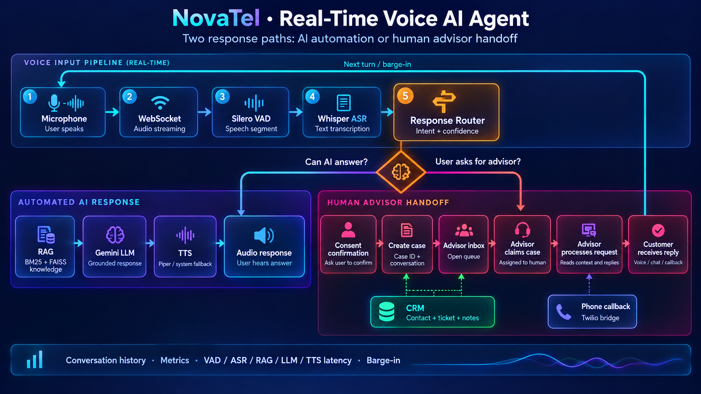
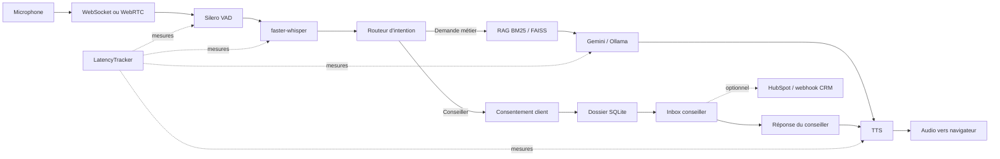
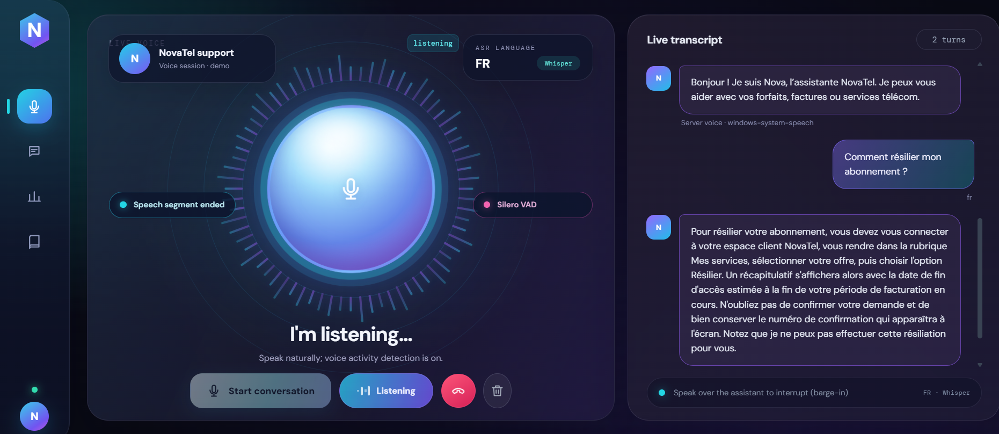
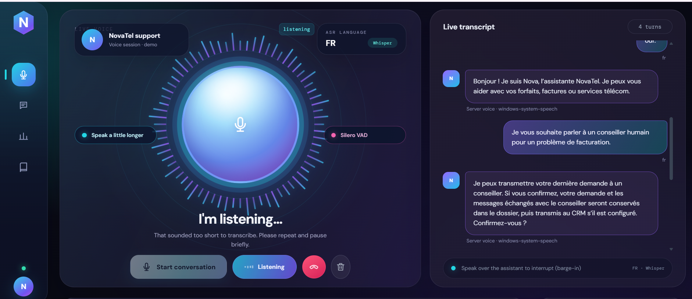
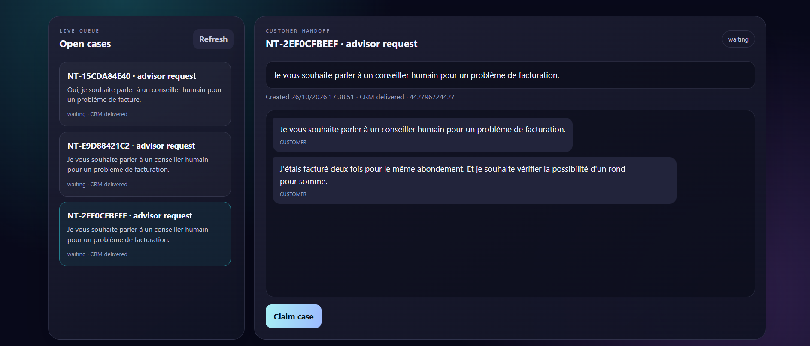
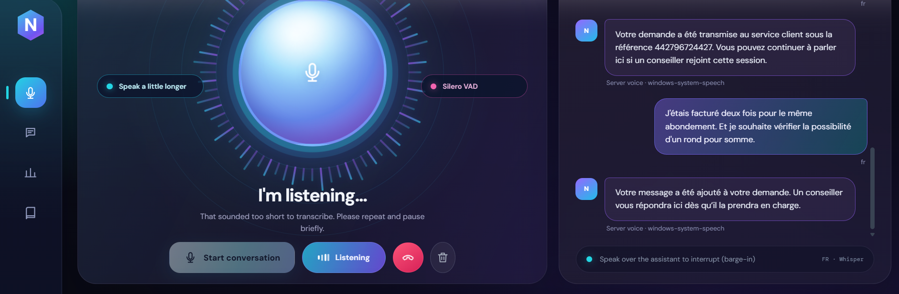

# NovaTel Real-Time Voice AI Agent

[](https://www.python.org/)
[](https://fastapi.tiangolo.com/)
[](#architecture)
[](#rag-et-routage)

Prototype vocal de service client pour **NovaTel**, un opérateur fictif. Le navigateur envoie la voix au backend, qui détecte la parole, transcrit le segment, choisit une réponse documentaire ou un transfert humain, puis restitue une réponse vocale.

Les procédures et offres NovaTel sont fictives. L'application n'accède pas à de vrais comptes clients. L'audio n'est pas conservé par défaut ; un dossier de transfert est persisté localement après consentement.

## Fonctionnalités

- Capture micro avec WebSocket PCM et transport WebRTC optionnel ; Silero VAD et faster-whisper.
- Routage d'intention, réponses sociales courantes, historique multi-tour et interruption (barge-in).
- RAG BM25, FAISS ou hybride, avec fallback lexical et abstention si les sources sont insuffisantes.
- LLM interchangeable : Gemini, Ollama ou API compatible OpenAI.
- TTS configurable (Piper, eSpeak NG ou Windows System.Speech) et audio transmis par frames.
- Transfert avec consentement vers une inbox conseiller ; connecteurs HubSpot et Twilio optionnels.
- Mesure des latences VAD, ASR, retrieval, LLM, TTS et bout en bout.

## Architecture



Le schéma visuel présente le circuit complet ; le diagramme Mermaid ci-dessous en donne une version modifiable.



Chaque session a son propre état, VAD et historique borné. Le routeur envoie une question métier au RAG ; il ne sollicite pas le LLM si aucun passage ne franchit le seuil défini. Une demande humaine nécessite le consentement du client avant de créer et transmettre le dossier.

## Captures d'écran

Les échanges et références visibles sont des données fictives de démonstration.

### Réponse à une question client



### Confirmation avant transfert humain



### Dossier dans l'inbox conseiller



### Confirmation du transfert au client



## Démarrage local

Prérequis : Python 3.11+, un navigateur récent et un microphone. Le navigateur peut accéder au micro depuis `localhost`.

Depuis PowerShell, à la racine du projet :

```powershell
py -3.11 -m venv .venv
.\.venv\Scripts\Activate.ps1
python -m pip install --upgrade pip
python -m pip install -e ".[dev]"
Copy-Item .env.example .env
notepad .env
```

Dans `.env`, renseigne `LLM_API_KEY` avec ta clé Google AI Studio. Gemini est le fournisseur configuré par défaut. Pour une inbox locale, ajoute aussi un jeton conseiller aléatoire :

```powershell
python -c "import secrets; print(secrets.token_urlsafe(32))"
```

Copie le résultat dans `AGENT_DASHBOARD_TOKEN` dans `.env`, puis lance :

```powershell
python -m uvicorn app.main:app --reload --host 127.0.0.1 --port 8000
```

Ouvre [http://127.0.0.1:8000](http://127.0.0.1:8000), démarre une conversation et autorise le microphone. L'état du serveur est disponible sur [http://127.0.0.1:8000/health](http://127.0.0.1:8000/health).

Le premier lancement peut télécharger les modèles Whisper et d'embeddings. Pour éviter le téléchargement du modèle dense RAG, définis `RAG_STRATEGY=bm25` dans `.env`. `python -m scripts.preload_whisper` télécharge et vérifie le modèle Whisper avant une démonstration.

Pour utiliser Ollama plutôt que Gemini, configure `LLM_BASE_URL=http://localhost:11434/v1` et `LLM_MODEL` dans `.env`, puis démarre Ollama avec le modèle choisi.

## Tester le transfert conseiller

1. Dans l'interface vocale, demande : « Je souhaite parler à un conseiller humain pour un problème de facturation. »
2. Confirme le partage lorsque Nova le demande.
3. Ouvre [http://127.0.0.1:8000/agent](http://127.0.0.1:8000/agent) et connecte-toi avec `AGENT_DASHBOARD_TOKEN`.
4. Réclame le dossier et réponds depuis l'inbox.

Par défaut, les dossiers sont locaux. HubSpot, le webhook CRM et Twilio sont des intégrations optionnelles ; elles nécessitent leurs propres identifiants et configuration dans `.env`. Twilio Trial est une démonstration d'appel, pas un pont téléphonique complet vers le pipeline vocal.

## Docker

Configure d'abord `.env`, puis lance depuis la racine :

```powershell
docker compose up --build
```

L'application est servie sur le port 8000. Les caches de modèles et données locales sont conservés dans les volumes configurés par Compose.

## Tests et évaluation

```powershell
python -m pytest -q
python -m ruff check app scripts tests
python -m scripts.evaluate_voice_agent
```

Les tests unitaires utilisent des mocks et ne téléchargent pas les modèles lourds. L'évaluation texte mesure le routage et le retrieval. WER/CER nécessite des audios de test consentis et des transcriptions de référence.

## Confidentialité et limites

- Ne commite jamais `.env` ni les jetons CRM/Twilio. Les dossiers de transfert consentis sont conservés dans SQLite local ; définis une politique d'effacement avant tout usage réel.
- Avec un LLM distant, la transcription, l'historique borné et les passages sélectionnés lui sont transmis. Utilise un fournisseur local si cette transmission n'est pas acceptable.
- Il s'agit d'un prototype mono-instance : l'inbox utilise un jeton partagé et SQLite local, sans SSO ni routage multi-agents.
- Le TTS est transmis en frames, mais les moteurs disponibles synthétisent encore par phrase. Les performances ASR varient selon le modèle et le matériel ; les mesures du prototype ne constituent pas une garantie de production.

## Repères dans le dépôt

- `app/api/` : routes HTTP, WebSocket, WebRTC et inbox.
- `app/pipeline/` : orchestration, routage et état de conversation.
- `app/speech/` : audio, Silero VAD, faster-whisper et TTS.
- `app/rag/` et `knowledge_base/novatel/` : ingestion et recherche documentaire.
- `app/llm/` : client LLM remplaçable.
- `app/tools/` : transfert humain et connecteurs.
- `app/monitoring/`, `evals/`, `tests/` : métriques, jeux d'évaluation et tests.
- `frontend/` : interface vocale et inbox conseiller.
